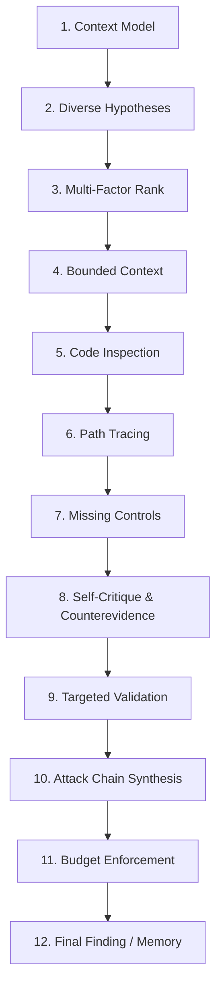

# Semantiq Security AI-First Investigation & Engineering Skill

> [!IMPORTANT]
> **Prerequisites & Constraints**:
> - Adhere to [`AGENTS.md`](file:///e:/Semantiq-Security/semantiq-security/AGENTS.md) at all times.
> - Package version must remain locked at `0.1.0`.
> - Keep the repository strictly private. Do not publish packages or create release tags.
> - Never execute target application code without isolated sandboxing.
> - Never fabricate AI calls, source evidence, validation outcomes, or benchmark metrics.
> - Never claim equivalence with Codex Security without independent, reproducible evidence.

This skill provides the authoritative operational guide for autonomous agents conducting security assessments using the **Semantiq Security** SDK, CLI, and Model Context Protocol (MCP) server.

---

## 1. Epistemological Grounding: 5 Analysis Levels

Every security finding, claim, and hypothesis must be classified into its precise epistemological category:

| Level | Classification | Definition & Evidentiary Standard |
| :--- | :--- | :--- |
| **L1** | **Source Facts** | Verifiable AST syntax, file bytes, line numbers, decorators, imports, and parameters extracted directly from disk. |
| **L2** | **Static Inferences** | Propagated interprocedural dataflows, call graphs, and type inferences with deterministic confidence. |
| **L3** | **AI Hypotheses** | Model-generated conjectures regarding potential exploitability, bypass routes, or business logic inconsistencies. Must be grounded in L1 facts. |
| **L4** | **Reproduced Behavior** | Findings confirmed through isolated test execution, reproducible fixtures, or verifiable constraint solvers. |
| **L5** | **Unresolved Uncertainty** | Regions involving dynamic dispatch (`getattr`, `eval`), external libraries, runtime callbacks, or incomplete dependencies where safety cannot be proven. |

> [!CAUTION]
> Never report an L3 AI hypothesis as an L4 confirmed exploit. Distinguish control flow from data flow, and mark unverified assumptions as `INCONCLUSIVE` or `CANDIDATE`.

---

## 2. The 12-Step AI Investigation Loop

### Step 1: Security-Context Modeling
Extract application entry points, trust boundaries, sensitive sinks, and unresolved regions:
- **MCP Tools**: `semantiq_inspect_repository(path=".")`, `semantiq_build_threat_model(path=".")`
- Catalog HTTP routes, background handlers, external sockets, and data persistence boundaries.

### Step 2: Diverse Hypothesis Generation across Complementary Strategies
Identify vulnerability hypotheses beyond predefined rules using multiple strategies:
1. **Architecture & Trust-Boundary Traversal**: Public unauthenticated routes reaching sensitive database queries, process executions, or external networks.
2. **Graph-Guided Dataflow**: Attacker-controlled parameters propagated across helper functions to sensitive sinks without sanitizers.
3. **Inconsistent Security Controls**: Alternate routes reaching the same sensitive operation where one route enforces authentication/roles and another omits them.
4. **Business-Logic & State Transitions**: Critical state advancements (e.g. order fulfillment, account upgrade, payment dispatch) executed without prior status verification.
5. **Cross-Component Attack Chains**: Multi-hop progressions spanning multiple service modules and privilege boundaries.
6. **Rule Findings as Amplification Signals**: Elevating AST pattern findings into interprocedural attack paths.

### Step 3: Multi-Factor Ranking
Prioritize hypotheses by composite score:
- **Potential Impact**: Remote code execution / SQLi (40) > State machine bypass / Auth bypass (32) > SSRF / File access (25) > Information exposure (15).
- **Reachability**: Public unauthenticated endpoint (30) > Authenticated endpoint (20) > Internal helper (10).
- **Novelty**: Cross-component multi-step chain (20) > Local function flaw (10).
- **Uncertainty & Risk**: Actively investigate high-impact leads with unverified neutralizing controls.

### Step 4: Bounded On-Demand Context Retrieval
Never dump entire repositories into LLM prompts. Retrieve targeted context:
- **MCP Tool**: `semantiq_get_source_excerpt(path, file_path, start_line, end_line, max_lines=50)`
- **MCP Tool**: `semantiq_query_neighborhood(path, node_id, radius=1)`
- Fetch exact source lines for entry points, target operations, and immediate graph neighbors.

### Step 5: Deep Code Inspection
Inspect actual source code rather than trusting derived summaries:
- Verify variable names, type conversions (`int()`, `float()`), parameter bindings, and context dictionaries.
- Confirm whether input values undergo transformations that neutralize the attack vector.

### Step 6: Path-Sensitive Tracing
Distinguish control flow from data flow:
- **Control Flow**: Call reachability (`semantiq_query_route_reachability`). Shows what *can execute*.
- **Data Flow**: Value propagation (`semantiq_query_dataflow_path`). Shows where *attacker data flows*.
- Do not treat call reachability as proof of dataflow or exploitability.

### Step 7: Search for Missing Controls & Bypasses
Check for security controls along the execution path:
- **Route Decorators**: `@login_required`, `@admin_required`, `@roles_accepted`.
- **Inline Guards**: `current_user.is_authenticated`, `session.get('user_id')`, `abort(403)`.
- **Tenant Scoping**: Queries filtering by `tenant_id` or `org_id`.
- **Alternate Routes**: Peer routes reaching the same handler (`semantiq_query_authorization_path`).

### Step 8: AI Self-Critique & Counterevidence Search
Act as a security skeptic. Search aggressively for evidence that disproves the hypothesis:
- Does upstream middleware sanitize or validate the payload?
- Is the route restricted to admin privileges?
- Is there a state precondition invariant enforced earlier in the workflow?
- If counterevidence exists, mark disposition as `mitigated` or `false_positive`.

### Step 9: Controlled Targeted Validation
Validate findings safely without intrusive production testing:
- **MCP Tool**: `semantiq_validate_finding(finding_id, mode="static")`
- Verify dataflow paths against formal taint rules and sanitizers.

### Step 10: Structured Attack-Chain Synthesis
Synthesize the complete attack chain connecting starting points to ultimate impacts:
- **MCP Tool**: `semantiq_query_attack_chains(path, max_depth=8)`
- Identify:
  1. Attacker starting point and capability (`unauthenticated_attacker` vs `authenticated_user`).
  2. Required preconditions (network access, parameter control, state prerequisites).
  3. Ordered sequence of operations with source locations and code snippets.
  4. Trust boundaries crossed.
  5. Potential impact and validation requirements.

### Step 11: Budget & Resource Bounds
Respect investigation limits:
- Maximum search depth, maximum files inspected, maximum hypotheses evaluated, and timeout seconds.
- Stop exploration and record explicit `INCONCLUSIVE` outcomes when limits are reached.

### Step 12: Production of Grounded Findings & Persistent Memory
Record findings backed by verifiable source citations:
- Persist hypotheses in repository memory: `semantiq_record_hypothesis(path, statement, target_symbol, entry_point, rule_id)`.
- Invalidate stale memory when source code revision changes.

---

## 3. Complete MCP Tool Suite Reference

| Tool Name | Purpose | Primary Inputs |
| :--- | :--- | :--- |
| `semantiq_inspect_repository` | Inventory files, detect languages, Git revision | `path` |
| `semantiq_build_threat_model` | Extract entry points, trust boundaries, sinks | `path` |
| `semantiq_scan_repository` | Deterministic security scan with category focus | `target`, `focus`, `mode` |
| `semantiq_scan_diff` | Security review focused on Git commit diff | `target`, `base`, `head` |
| `semantiq_get_findings` | Retrieve findings recorded for a scan ID | `scan_id` |
| `semantiq_investigate_finding` | Deep local context investigation on finding | `finding_id` |
| `semantiq_validate_finding` | Validate finding (static, test_based, dynamic) | `finding_id`, `mode` |
| `semantiq_propose_patch` | Generate security invariant unified diff patch | `finding_id` |
| `semantiq_verify_patch` | Test patch in isolated in-memory AST copy | `finding_id` |
| `semantiq_export_report` | Export findings (JSON, Markdown, SARIF 2.1.0) | `scan_id`, `format` |
| `semantiq_query_symbols` | Search symbols in Semantic Program Graph | `path`, `query`, `kind`, `limit` |
| `semantiq_query_callers_callees` | Lookup inbound/outbound calls for symbol | `path`, `symbol_name`, `direction` |
| `semantiq_query_neighborhood` | Extract bounded subgraph around node | `path`, `node_id`, `radius` |
| `semantiq_query_dataflow_path` | Trace route-to-sink dataflow paths | `path`, `source_symbol`, `sink_category` |
| `semantiq_query_route_reachability` | Trace route call chains to dangerous operations | `path`, `route_path`, `sink_kind` |
| `semantiq_query_authorization_path` | Inspect route auth boundaries and queries | `path`, `route_path` |
| `semantiq_query_tenant_isolation` | Inspect database paths for tenant scoping | `path`, `with_ownership_check` |
| `semantiq_get_analysis_gaps` | Report dynamic dispatch and unparsed files | `path` |
| `semantiq_record_hypothesis` | Record hypothesis in persistent memory | `path`, `statement`, `rule_id` |
| `semantiq_get_evidence` | Retrieve verified code citations and dataflow | `finding_id` |
| `semantiq_get_source_excerpt` | Bounded source code lines and syntax details | `path`, `file_path`, `start_line`, `end_line`, `max_lines` |
| `semantiq_query_attack_chains` | Discover multi-step cross-component attack chains | `path`, `max_depth` |

---

## 4. Engineering Quality Checklist

Before finalizing any task or committing changes:
- [ ] Version declaration across all files is strictly `0.1.0`.
- [ ] No target repository code is executed without explicit opt-in.
- [ ] Path resolution strictly prevents traversal and NTFS stream bypasses (`resolve_safe_path`).
- [ ] No live credentials exist in fixtures, code, or logs.
- [ ] All new functions and public APIs are fully typed and pass `mypy`.
- [ ] `pytest -v` passes with 0 failures.
- [ ] `ruff check .` reports 0 errors.
- [ ] Benchmark runner (`python benchmarks/run_benchmark.py`) passes without fabricated parity claims.
- [ ] Remote `origin/main` is up-to-date and clean.
