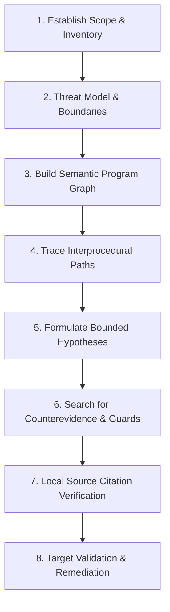

# Semantiq Security Investigation & Engineering Skill

> [!IMPORTANT]
> **Prerequisites & Constraints**:
> - Adhere to [`AGENTS.md`](file:///e:/Semantiq-Security/semantiq-security/AGENTS.md) at all times.
> - Package version must remain locked at `0.1.0`.
> - Keep the repository strictly private. Do not publish packages or create release tags.
> - Never execute target application code without isolated sandboxing.
> - Never fabricate benchmark metrics or claim parity with external systems (Codex Security) without reproducible evidence.

This skill provides the authoritative operational guide for autonomous agents conducting security assessments using the **Semantiq Security** SDK, CLI, and Model Context Protocol (MCP) server.

---

## 1. Agent Security Investigation Methodology

### Phase 1: Establish Assessment Scope
Before inspecting source code, identify repository boundaries, language distribution, and file inventory:
- **MCP Tool**: `semantiq_inspect_repository(path=".")`
- **Actions**:
  1. Record total files on disk vs in-scope files.
  2. Identify supported languages (Python, JavaScript, TypeScript) and unsupported extensions.
  3. Inspect Git revision and dirty state.
  4. Note any ignored or excluded directories (`.git`, `node_modules`, `venv`, `build`).

### Phase 2: Query Architecture & Threat Model
Identify entry points, trust boundaries, and protected assets:
- **MCP Tool**: `semantiq_build_threat_model(path=".")`
- **Actions**:
  1. Map all external HTTP routes, request handlers, and CLI entry points.
  2. Enumerate trust boundaries separating unauthenticated callers from internal services.
  3. Catalog sensitive database models, file storage, and external network sinks.

### Phase 3: Semantic Program Graph (SPG) Exploration
Query the versioned, typed Semantic Program Graph to understand code relationships:
- **MCP Tools**:
  - `semantiq_query_symbols(path, query, kind, file_path)`: Inspect functions, classes, and routes.
  - `semantiq_query_callers_callees(path, symbol_name, direction="both")`: Examine inbound and outbound call relationships.
  - `semantiq_query_neighborhood(path, node_id, radius=1)`: Extract bounded subgraphs for local reasoning without reading entire repositories.

### Phase 4: Interprocedural Data-Flow & Reachability Tracing
Trace attacker-controlled parameters from routes to sensitive operations across helper services:
- **MCP Tools**:
  - `semantiq_query_route_reachability(path, route_path, sink_kind)`: Trace call chains from routes to sensitive sinks (`query`, `process_exec`, `external_request`, `file_operation`).
  - `semantiq_query_dataflow_path(path, source_symbol, sink_category, max_depth=10)`: Trace end-to-end dataflow, checking for parameter propagation and context-sensitive sanitizers.

### Phase 5: Authorization & Tenant Boundary Inspection
Distinguish authentication from object authorization, and trace tenant scoping invariants:
- **MCP Tools**:
  - `semantiq_query_authorization_path(path, route_path)`: Inspect route authentication decorators (`@login_required`), authorization checks (`@admin_required`, `@roles_accepted`), and database queries executed.
  - `semantiq_query_tenant_isolation(path, with_ownership_check)`: Identify database access paths lacking tenant ownership comparison clauses (`WHERE tenant_id = ?`).

### Phase 6: Formulate & Challenge Hypotheses
Develop explicit vulnerability hypotheses with required preconditions and counterevidence:
- **MCP Tool**: `semantiq_record_hypothesis(path, statement, target_symbol, entry_point, rule_id, disposition)`
- **Rule of Evidence**:
  - Do not assert missing authorization merely because a local function lacks an inline guard; check the route decorator and middleware stack.
  - Look for sanitizers: `validate_url()` neutralizes SSRF; `int()` neutralizes SQL injection; `escape()` neutralizes XSS.
  - Check state machine invariants: ensure fulfilling an order requires prior payment verification (`SQ-PY-018`).

### Phase 7: Read & Locally Verify Source Citations
Verify that all model-generated code claims correspond to real lines on disk:
- **MCP Tool**: `semantiq_get_evidence(finding_id)`
- **Actions**:
  1. Verify file paths exist and lines are within file bounds.
  2. Compare code snippet text with actual disk contents.
  3. Reject or mark unvalidated any hypothesis citing non-existent lines or hallucinated helper functions.

### Phase 8: Analysis Gap Accounting & Uncertainty Reporting
Inspect dynamic dispatches, unparsed files, and foreign libraries:
- **MCP Tool**: `semantiq_get_analysis_gaps(path)`
- **Actions**:
  - Report dynamic dispatches (`getattr()`, `eval()`) as `INCONCLUSIVE` rather than assuming safety.
  - Report unparsed or skipped files as partial coverage in the evaluation summary.

### Phase 9: Controlled Validation & Remediation
Validate findings through static dataflow or targeted regression tests:
- **MCP Tools**:
  - `semantiq_validate_finding(finding_id, mode="static")`
  - `semantiq_propose_patch(finding_id)`
  - `semantiq_verify_patch(finding_id)`: Applies patch to an in-memory temporary AST buffer, verifying syntax validity and re-scanning to ensure vulnerability elimination.

---

## 2. Complete MCP Tool Suite Reference

| Tool Name | Purpose | Primary Inputs |
| :--- | :--- | :--- |
| `semantiq_inspect_repository` | Inventory files, detect languages, Git revision | `path` |
| `semantiq_build_threat_model` | Extract entry points, trust boundaries, sinks | `path` |
| `semantiq_scan_repository` | Deterministic security scan with category focus | `target`, `focus`, `mode` |
| `semantiq_scan_diff` | Security review focused on Git commit diff | `target`, `base`, `head` |
| `semantiq_get_findings` | Retrieve findings recorded for a scan ID | `scan_id` |
| `semantiq_investigate_finding` | Deep local context investigation on finding | `finding_id` |
| `semantiq_validate_finding` | Validate finding (static, test_based, dynamic) | `finding_id`, `mode` |
| `semantiq_propose_patch` | Generate security invariant unified diff patch | `finding_id` |
| `semantiq_verify_patch` | Test patch in isolated in-memory AST copy | `finding_id` |
| `semantiq_export_report` | Export findings (JSON, Markdown, SARIF 2.1.0) | `scan_id`, `format` |
| `semantiq_query_symbols` | Search symbols in Semantic Program Graph | `path`, `query`, `kind`, `limit` |
| `semantiq_query_callers_callees` | Lookup inbound/outbound calls for symbol | `path`, `symbol_name`, `direction` |
| `semantiq_query_neighborhood` | Extract bounded subgraph around node | `path`, `node_id`, `radius` |
| `semantiq_query_dataflow_path` | Trace route-to-sink dataflow paths | `path`, `source_symbol`, `sink_category` |
| `semantiq_query_route_reachability` | Trace route call chains to dangerous operations | `path`, `route_path`, `sink_kind` |
| `semantiq_query_authorization_path` | Inspect route auth boundaries and queries | `path`, `route_path` |
| `semantiq_query_tenant_isolation` | Inspect database paths for tenant scoping | `path`, `with_ownership_check` |
| `semantiq_get_analysis_gaps` | Report dynamic dispatch and unparsed files | `path` |
| `semantiq_record_hypothesis` | Record hypothesis in persistent memory | `path`, `statement`, `rule_id` |
| `semantiq_get_evidence` | Retrieve verified code citations and dataflow | `finding_id` |

---

## 3. Engineering Quality Checklist

Before finalizing any task or committing changes:
- [ ] Version declaration across all files is strictly `0.1.0`.
- [ ] No target repository code is executed without explicit opt-in.
- [ ] Path resolution strictly prevents traversal and NTFS stream bypasses (`resolve_safe_path`).
- [ ] No live credentials exist in fixtures, code, or logs.
- [ ] All new functions and public APIs are fully typed and pass `mypy`.
- [ ] `pytest -v` passes with 0 failures.
- [ ] `ruff check .` reports 0 errors.
- [ ] Benchmark runner (`python benchmarks/run_benchmark.py`) passes without fabricated parity claims.
- [ ] Remote `origin/main` is up-to-date and clean.
