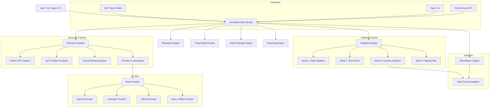

# Semantiq Security Architecture

**Product:** Semantiq Security  
**Distribution:** `semantiq`  
**Import:** `from semantiq import Semantiq`  
**Maintainer:** Lakshmikanthan K (`letchupkt` / `l3tchupkt`)

---

## 1. Architectural Philosophy

Semantiq Security is designed around four foundational principles:

1. **Offline-First Determinism:** Core security scanning, vulnerability discovery, threat modeling, and report generation must function with zero network access and no LLM API keys. AI is an optional enrichment layer, not a hard prerequisite.
2. **Evidence Over Appearances:** A vulnerability finding is valid only when supported by verifiable source evidence (code snippets, dataflow paths, source-to-sink connections). Hypothetical assertions without code backing are classified as unvalidated or rejected.
3. **Defense-in-Depth Against Untrusted Repositories:** Code repositories under audit must be treated as hostile inputs. Semantiq never executes repository code during static scans, validates paths to prevent traversal and symlink escapes, rejects Windows NTFS alternate streams, and uses strict argument arrays rather than shell commands.
4. **Agent-Native Modularity:** While providing an ergonomic Python SDK and CLI, Semantiq exposes standard Model Context Protocol (MCP) tools and typed contracts suitable for autonomous AI agents (Claude Code, OpenCode, Antigravity, LangGraph).

---

## 2. Component Architecture



---

## 3. Core Modules Description

### 3.1 `semantiq.client.Semantiq`
The primary public facade. Supports both asynchronous context manager usage (`async with Semantiq() as security:`) and direct programmatic invocation. Exposes high-level workflows:
- `inspect_repository(path)`
- `build_threat_model(path)`
- `scan(target, focus, mode)`
- `scan_diff(target, base, head)`
- `get_findings(scan_id)`
- `investigate(finding_id)`
- `validate(finding_id, mode)`
- `propose_patch(finding_id)`
- `verify_patch(finding_id, patch)`
- `export_report(scan_id, format)`

### 3.2 `semantiq.repository`
- **`inspector.py`:** Resolves targets safely, canonicalizes paths, verifies repository boundaries, and filters files using configurable include/exclude rules (pruning `.git`, virtual environments, `node_modules`, build outputs).
- **`git.py`:** Inspects Git revision, branch name, dirty state, and generates diffs for focused pull-request reviews.
- **`safepath.py`:** Defends against path traversal, directory escapes, symlink attacks, and Windows NTFS alternate data streams (`filename:stream`).

### 3.3 `semantiq.analysis` & `semantiq.discovery`
- **`python_ast.py`:** Pure-Python AST visitor detecting dangerous sinks:
  - Command Injection: `subprocess` calls with `shell=True`, `os.system`, `os.popen`.
  - SQL Injection: String formatting and f-strings inside DB-API `execute()` methods.
  - Path Traversal: Dynamic file access via `open()`, `os.path.join()`, Flask `send_file()`.
  - SSRF: Dynamic network requests via `requests.get()`, `httpx.post()`, `urllib.request()`.
  - Unsafe Deserialization: `pickle.loads()`, `yaml.load()` without SafeLoader, `marshal.loads()`.
  - Insecure Cryptography: `hashlib.md5()` / `sha1()` in security contexts, weak pseudo-random generation for tokens.
  - Insecure File Operations: `chmod 0o777`, `tempfile.mktemp()`.
- **`regex_patterns.py`:** Structural and token-pattern analyzer for JavaScript and TypeScript files (eval, `child_process.exec`, unsafe raw SQL, unsanitized file system read/write).
- **`secrets.py`:** High-entropy credential scanner scanning for API tokens, private keys, AWS secrets, with automated heuristic false-positive reduction for test fixtures and mock variables.
- **`context.py`:** Gathers surrounding code blocks, enclosing function/class definitions, and caller hierarchy to enrich findings.

### 3.4 `semantiq.threat_model`
- **`generator.py`:** Deterministically extracts entry points (FastAPI/Flask route decorators, CLI argument parsers), trust boundaries (network vs local, public vs admin), sensitive sinks, and authentication controls from the repository's AST.
- **`model.py`:** Pydantic models for ThreatModel, Asset, EntryPoint, TrustBoundary, and SensitiveOperation.

### 3.5 `semantiq.providers`
- **`base.py`:** Defines the `BaseProvider` contract with rate limiting, timeouts, and structured output parsing.
- **`openai_provider.py`**, **`anthropic_provider.py`**, **`ollama_provider.py`**: Concrete HTTP-based integrations using `httpx`.
- **`mock_provider.py`**: Offline deterministic stub for test execution.
- **`verifier.py`:** Validates model-cited file paths, line numbers, and code excerpts against the actual repository files to prevent AI hallucinations.

### 3.6 `semantiq.validation`
- **`engine.py`:** Executes 4 distinct validation strategies:
  1. *Mode 1 (Static):* Verifies source-to-sink reachability and absence of sanitizers in the AST.
  2. *Mode 2 (Test-based):* Generates or executes pytest regression tests in a controlled fixture.
  3. *Mode 3 (Dynamic Sandbox):* Executes isolated tests in a sandboxed subprocess with strict user opt-in (`allow_execution=True`).
  4. *Mode 4 (Manual Plan):* Generates a concrete reproduction writeup detailing prerequisites, inputs, and expected outcomes.

### 3.7 `semantiq.sandbox`
- **`executor.py`:** Process execution security:
  - Invokes commands with strict argument arrays (`argv: list[str]`), rejecting `shell=True`.
  - Enforces execution timeouts and maximum stdout/stderr capture buffers to prevent memory exhaustion.
  - Automatically manages isolated scratch directories (`tempfile.TemporaryDirectory`).

### 3.8 `semantiq.remediation`
- **`generator.py`:** Generates standard unified diff patches targeting vulnerable functions while enforcing security invariants.
- **`verifier.py`:** Applies proposed patches to an isolated temporary copy of the codebase, re-executes the scanner and regression tests, and confirms vulnerability mitigation without functional regressions.

### 3.9 `semantiq.storage`
- **`sqlite.py`:** SQLite database persistence storing scans, findings, validations, patches, and threat models. Includes automatic schema creation and migrations.

### 3.10 `semantiq.reporting`
- **`exporter.py`:** Serializes results into:
  - Structured JSON (`findings.json`, `scan-manifest.json`).
  - Human-readable Markdown reports (`report.md`).
  - Standard OASIS SARIF 2.1.0 (`results.sarif`) for GitHub Code Scanning integration.

### 3.11 `semantiq.integrations`
- **`mcp/`:** Standard Model Context Protocol (MCP) JSON-RPC stdio server exposing 10 security research tools.
- CLI: Typer-based command-line tool with rich terminal formatting.

---

## 4. Exception Hierarchy

```
SemantiqError (Base)
├── ConfigurationError
├── RepositoryError
│   ├── TargetNotFoundError
│   ├── PathTraversalError
│   ├── SymlinkEscapeError
│   └── ScopeViolationError
├── AnalysisError
│   ├── ParseError
│   └── AnalyzerExecutionError
├── ProviderError
│   ├── ProviderAuthenticationError
│   ├── ProviderRateLimitError
│   ├── ProviderTimeoutError
│   └── CitationVerificationError
├── ValidationError
│   ├── ExecutionNotPermittedError
│   └── SandboxTimeoutError
├── RemediationError
│   └── PatchApplicationError
└── StorageError
```
