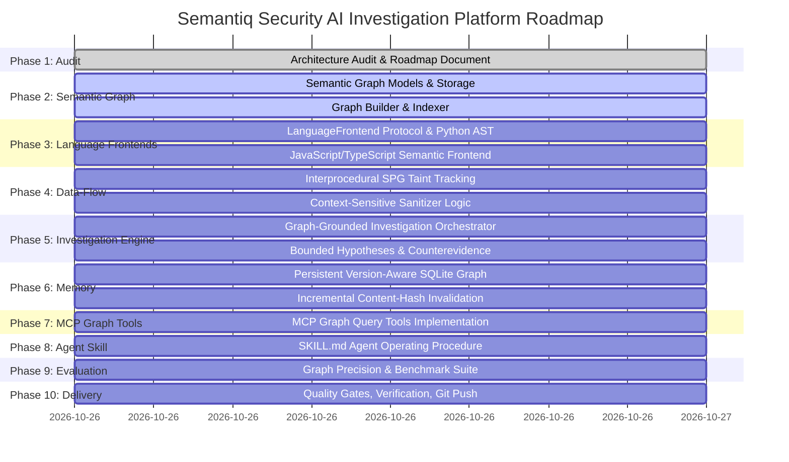

# Semantiq Security — Semantic Program Graph & AI Investigation Architecture
## Version 0.1.0 — Architecture Audit & Phased Implementation Plan

### 1. Executive Summary & Architecture Audit

An audit of the Semantiq Security (`semantiq`) codebase was conducted against the latest commit `cdcd0f9` and working tree state.

#### 1.1 What Genuinely Exists & Is Tested
1. **Repository Inventory & File Safety (`semantiq.repository`):**
   - Path traversal, directory escape, symlink verification, and Windows NTFS alternate stream defenses in `safepath.py` (6 unit tests).
   - Git repository introspection and diff extraction (`git.py`).
   - PathSpec-based file inventory filtering (`inspector.py`).
2. **Repository Intelligence & Basic Call Indexing (`semantiq.repository.intelligence`):**
   - AST symbol extraction (`IndexedSymbol`), import tracking (`IndexedImport`), and unresolved dynamic call tracking (`UnresolvedCall`).
   - SHA-256 file content caching for incremental re-indexing.
   - Route and authentication boundary mapping (`AuthBoundary`).
3. **Deterministic AST Vulnerability Analysis (`semantiq.analysis.python_ast`):**
   - Deterministic AST visitors for 18 vulnerability categories (`SQ-PY-001` through `SQ-PY-018`).
   - Context-aware taint tracking for variables, arguments, and return statements within functions.
4. **Investigation Orchestration (`semantiq.discovery.orchestrator`):**
   - 7-phase evidence gathering: architectural defect discovery, backward call chain tracing to HTTP entry points, hypothesis formulation, supporting/counterevidence evaluation, optional AI assistance, citation verification, and multi-factor prioritization scoring.
5. **Persistence & Remediation (`semantiq.storage`, `semantiq.remediation`):**
   - SQLite persistence for scans, findings, threat models, validations, and patches.
   - Unified diff patch generation with isolated in-memory AST syntax validation.
6. **Interfaces & Integration:**
   - Typer CLI with 11 commands.
   - MCP Server over stdio providing 10 security research tools.
   - Verified benchmark suite measuring instance-level precision and recall across synthetic and multi-tier SaaS test fixtures.

#### 1.2 What Is Partial or Relies on Heuristics
1. **Call Graph & Relationship Representation:**
   - Currently, `CallEdge` records only string pairs (`caller_file`, `caller_symbol`, `callee_name`, `line`).
   - There is no unified, typed graph schema with stable node identifiers, provenance, or explicit edge categories (`PASSES_ARGUMENT`, `RETURNS_TO`, `DATA_FLOWS_TO`, `CONTROLS_FLOW`, `AUTHENTICATES`, `AUTHORIZES`, `QUERIES`, `CONTROLS_TENANT`).
2. **Language Frontends:**
   - Python is deeply analyzed via `ast`.
   - JavaScript/TypeScript is only scanned using regular expressions in `regex_patterns.py`. It is skipped during AST indexing (`if lang == "python"`), meaning non-Python files produce no symbol tables, import trees, or call graph edges.
3. **Interprocedural Data-Flow:**
   - `interprocedural.py` extracts basic function taint summaries, but does not propagate taint across multi-hop object methods, dictionary lookups, or cross-module database abstraction layers dynamically.
4. **Architectural Vulnerability Reasoning:**
   - BOLA (`SQ-PY-013`), Missing Auth (`SQ-PY-014`), and Cross-Tenant Leakage (`SQ-PY-015`) rely on naming conventions (e.g. `document`, `profile`, `tenant_id`) and regex pattern matching rather than traversing typed graph paths between route parameters, authorization checks, and database queries.
5. **Investigation Memory:**
   - Scan results are saved to SQLite, but the repository graph itself is discarded after the scan completes. Incremental graph updates and version-aware investigation memory across Git revisions are not persisted.

#### 1.3 What Is Missing
1. **Typed Semantic Program Graph (SPG):** A versioned, queryable graph connecting repository entities (files, classes, functions, routes, variables, models, sinks, auth controls, hypotheses, evidence).
2. **Language Frontend Abstraction (`LanguageFrontend`):** An extensible interface allowing Python, JavaScript, and TypeScript frontends to generate uniform graph nodes and edges.
3. **Agent MCP Graph Query Tools:** Dedicated MCP tools for AI agents to query symbols, callers/callees, route-to-sink reachability, data-flow paths, and tenant boundary crossings.
4. **Persistent Graph & Investigation Memory:** Disk/database storage of graph nodes, edges, content hashes, and hypothesis dispositions.

---

### 2. Semantic Program Graph (SPG) Architecture (Phase 2)

#### 2.1 Node Schema
Each node in the Semantic Program Graph implements `GraphNode` with:
- `id`: Stable composite key (e.g., `sym:multitenant_saas_app/app.py:document_view`, `route:/api/v1/tenant/documents/<doc_id>`).
- `kind`: Enumerated node type:
  - Structure: `REPOSITORY`, `FILE`, `MODULE`, `PACKAGE`
  - Code: `CLASS`, `FUNCTION`, `METHOD`, `CALL_SITE`
  - Entry Points: `ROUTE`, `REQUEST_HANDLER`, `MIDDLEWARE`, `EVENT_CONSUMER`
  - Data: `PARAMETER`, `VARIABLE`, `EXPRESSION`, `RETURN_VALUE`
  - Storage: `DATABASE_MODEL`, `QUERY`, `DATA_ACCESS`
  - Sinks: `EXTERNAL_REQUEST`, `FILE_OPERATION`, `PROCESS_EXEC`, `SENSITIVE_SINK`
  - Security Controls: `AUTH_CONTROL`, `AUTHORIZATION_CHECK`, `VALIDATION`, `SANITIZER`
  - Context & Boundaries: `TRUST_BOUNDARY`, `SENSITIVE_RESOURCE`, `TENANT_CONTEXT`
  - Reasoning: `VULNERABILITY_HYPOTHESIS`, `EVIDENCE_ITEM`, `FINDING`, `VALIDATION_RESULT`
- `label`: Human-readable name.
- `file_path`: Path relative to repository root.
- `start_line` / `end_line`: Source coordinate bounds.
- `provenance`: Provenance indicator (`DIRECT_FACT`, `STATICALLY_INFERRED`, `UNRESOLVED`, `MODEL_PROPOSED`).
- `source_revision`: Git commit hash or SHA-256 content hash.
- `properties`: Flexible metadata dictionary (e.g., framework, HTTP methods, decorator names, parameters).

#### 2.2 Edge Schema
Each edge implements `GraphEdge` with:
- `source_id`: Source node identifier.
- `target_id`: Target node identifier.
- `kind`: Enumerated relationship:
  - `IMPORTS`: Module/symbol import dependency.
  - `DEFINES`: Structural containment (file defines function, class defines method).
  - `CALLS`: Direct or inferred invocation.
  - `PASSES_ARGUMENT`: Caller argument to callee parameter binding.
  - `RETURNS_TO`: Function return value to caller assignment.
  - `DATA_FLOWS_TO`: Value propagation and taint transfer.
  - `CONTROLS_FLOW`: Branch condition guarding execution.
  - `REACHES`: Route or symbol reachability to downstream sink.
  - `AUTHENTICATES`: Authentication requirement (e.g., `@login_required`).
  - `AUTHORIZES`: Object or role authorization check (e.g., `@admin_required`, `has_permission`).
  - `VALIDATES`: Input format and range validation.
  - `SANITIZES`: Vulnerability-specific neutralization (e.g., `int()`, `escape()`).
  - `QUERIES`: Execution of SQL/ORM statement.
  - `ACCESSES_RESOURCE`: Retrieval or mutation of protected entity.
  - `CONTROLS_TENANT`: Tenant isolation enforcement clause.
  - `MITIGATES`: Security control neutralizing a hypothesis.
- `provenance`: `DIRECT_FACT`, `STATICALLY_INFERRED`, `UNRESOLVED`.
- `confidence`: Confidence score (0.0 to 1.0).
- `properties`: Metadata dictionary (e.g., argument index, line number, sanitizer category).

#### 2.3 Graph Engine & Query Capabilities
The in-memory, disk-cacheable `SemanticProgramGraph` provides indexed adjacency maps supporting:
1. `get_callers(symbol_id)` and `get_callees(symbol_id)`.
2. `find_paths(source_id, target_id, edge_kinds, max_depth)`.
3. `find_route_to_sink_paths(route_node_id, sink_category)`.
4. `find_unauthorized_access_paths(resource_type)`.
5. `find_unresolved_regions()`: Identifies call sites crossing `UnresolvedCall` boundaries.
6. `get_neighborhood(node_id, radius)`: Extracts bounded subgraph for agent investigation.

---

### 3. Phased Implementation Plan

#### Detailed Phase Commitments
- **Phase 2 (Semantic Graph):** Create `src/semantiq/graph/models.py`, `src/semantiq/graph/graph.py`, and `src/semantiq/graph/builder.py`. Provide stable node IDs, typed edges, graph traversal, and serialization.
- **Phase 3 (Language Frontends):** Create `src/semantiq/languages/base.py`, refactor Python frontend into `src/semantiq/languages/python.py`, and implement a language-aware JavaScript/TypeScript frontend in `src/semantiq/languages/javascript.py` resolving module imports, exports, functions, routes, and call sites.
- **Phase 4 (Interprocedural Data-Flow):** Implement interprocedural taint propagation directly on the SPG in `src/semantiq/analysis/spg_dataflow.py`, connecting route parameters -> function arguments -> transformations -> database/network sinks, respecting sanitizers.
- **Phase 5 (AI Investigation Engine):** Upgrade `InvestigationOrchestrator` to operate on the SPG, querying neighborhood subgraphs, generating hypothesis nodes, and verifying counterevidence.
- **Phase 6 (Persistent Memory):** Extend `SQLiteStorage` with tables for graph nodes, edges, and investigation hypotheses with SHA-256 and Git revision cache keys.
- **Phase 7 (MCP Tools):** Add 6 new MCP tools: `semantiq_query_symbols`, `semantiq_query_callers_callees`, `semantiq_query_dataflow_path`, `semantiq_query_route_reachability`, `semantiq_query_tenant_isolation`, and `semantiq_get_analysis_gaps`.
- **Phase 8 (Agent Skill):** Rewrite `SKILL.md` to guide agents in using the semantic graph query tools to investigate hypotheses, verify evidence against source, and validate findings.
- **Phase 9 (Evaluation):** Extend benchmarks with tests measuring graph node/edge accuracy, call graph precision/recall, and data-flow path correctness.
- **Phase 10 (Delivery):** Run Pytest, Ruff, Mypy, build, benchmark, inspect Git diff, and push to `origin/main`.
