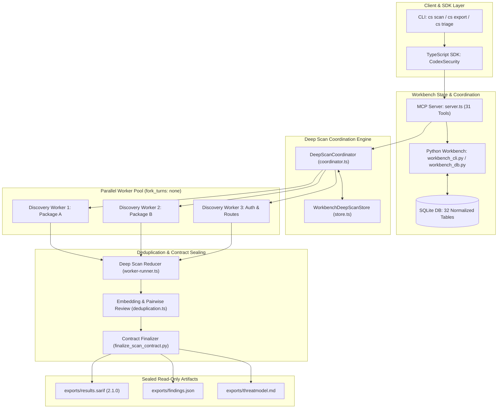
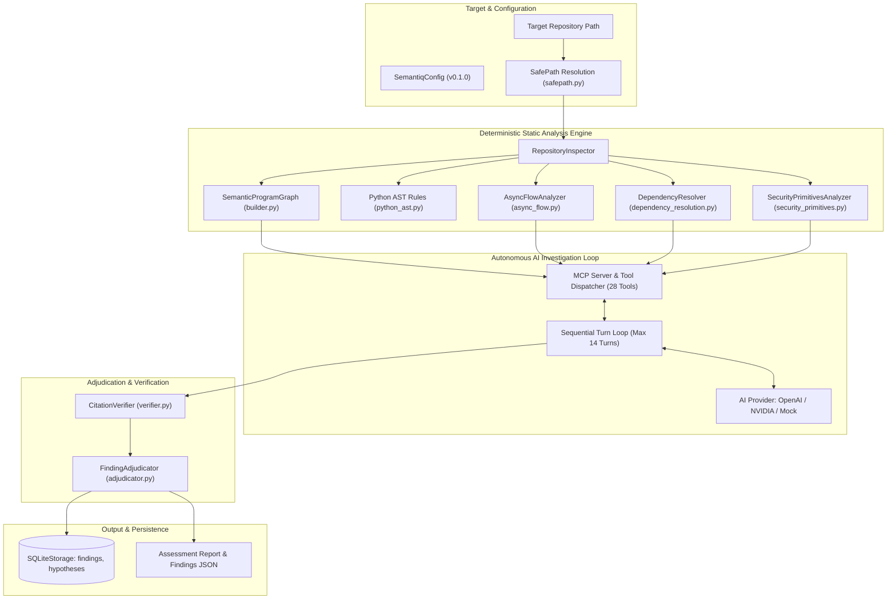
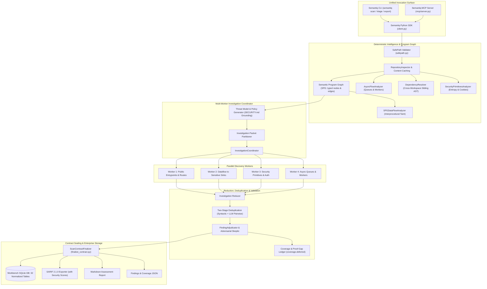

# Semantiq Security — Architecture & Execution Flow Study

## Executive Summary

This document presents a comparative visual and procedural analysis of the execution architectures of **Codex Security** and **Semantiq Security**. It traces their lifecycles across Standard, Deep, and Diff scan modes, and proposes a **Unified Target Architecture** for Semantiq Security that combines Semantiq's superior deterministic program graph with Codex's proven multi-worker reduction, evidence schema, and contract sealing models.

---

## 1. Codex Security Execution Architecture

Codex Security operates as a multi-tier hybrid agent system. The diagram below illustrates the flow from CLI invocation through parallel worker execution, SQLite state persistence, and sealed contract finalization:

---

## 2. Current Semantiq Security Execution Architecture

Semantiq Security currently relies on a single-thread linear investigation loop connecting an AI model to deterministic static analysis tools:

---

## 3. Unified Target Architecture for Semantiq Security

The Unified Target Architecture merges Semantiq's deterministic code graph advantage with Codex's multi-worker coordination, rich evidence schema, and contract sealing:

---

## 4. Step-by-Step Lifecycle Comparison

The table below contrasts the exact step-by-step lifecycle flow between the Codex Security reference and the Semantiq Security target design:

| Lifecycle Stage | Codex Security Reference | Current Semantiq Implementation | Semantiq Target Architecture |
| :--- | :--- | :--- | :--- |
| **1. Target Specification** | Paths validated via PathSpec; git revisions hashed into `snapshotDigest`. | Paths validated via `resolve_safe_path`; protects against traversal and NTFS streams. | Combine `resolve_safe_path` with repository snapshot digest calculation for incremental caching. |
| **2. Policy & Threat Model** | Reads root/scoped `SECURITY.md`; generates structured Markdown threat model. | `ThreatModelExtractor` extracts routes and sinks; no explicit `SECURITY.md` parsing. | Integrate `SECURITY.md` resolver into `ThreatModelExtractor` to ground trust boundaries in policy. |
| **3. Packet Partitioning** | Partitions codebase into investigation packets by actor, entrypoint, and control. | Single global scope explored sequentially by one model. | Introduce `InvestigationPacketer` to divide large repositories into focused component scopes. |
| **4. Discovery Phase** | Parallel discovery workers run in sub-processes (`fork_turns: "none"`). | Single-threaded turn loop (max 14 turns) queries MCP tools. | `InvestigationCoordinator` spawns parallel discovery workers over component packets. |
| **5. Evidence Retrieval** | `ripgrep`, `git grep`, bounded source slices (`get_source_excerpt`). | SPG graph queries (`query_symbols`, `query_callers_callees`, `get_source_excerpt`). | Retain SPG graph tools and augment with bounded third-party dependency source slicing. |
| **6. Counterevidence & Proof Gaps** | Strict falsification rubric; records mitigating guards; logs missing runtime facts as Proof Gaps. | Adjudicator checks mitigations; lacks structured proof gap tracking. | Adopt Codex's Assessment Tuple ($$\text{Source}, \text{Control}, \text{Sink}, \text{Path}, \text{Boundary}, \text{Counterevidence}, \text{Proof Gaps}$$). |
| **7. Finding Deduplication** | Vector embeddings (1536d) cluster findings; LLM pairwise reviewer merges them. | Syntactic fingerprint hash (`rule_id + file + line`). | Two-stage deduplication: cluster by file/CWE/root cause, then run LLM pairwise merge. |
| **8. Contract Sealing** | 3,411-line `finalize_scan_contract.py` verifies citations on disk and seals read-only files. | `verify_finding_citations` checks local files and dependency paths. | Formalize `ScanContractFinalizer` validating JSON schemas, line bounds, and sealed manifests. |
| **9. Database Persistence** | 32 SQLite tables tracking scans, findings, locations, occurrences, triage, remediation. | 2 SQLite tables (`findings`, `hypotheses`). | Expand `SQLiteStorage` to persist complete scan runs, occurrences, coverage, and triage state. |
| **10. Reporting & Export** | SARIF 2.1.0 with security scores (9.5/8.0/5.0/2.0), CSV, Markdown, findings JSON. | JSON, Markdown, and standard SARIF export. | Update SARIF exporter with NIST/GitHub security scores and rich semantic code evidence roles. |

