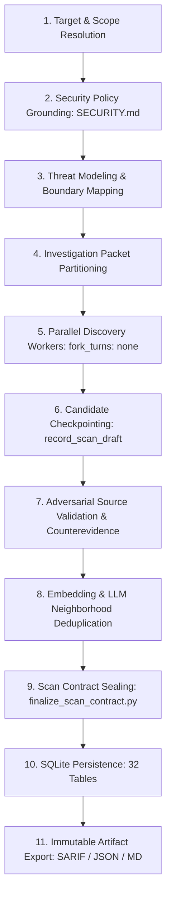

# Codex Security — Reverse Engineering & Architectural Study

## Executive Summary

This study documents a reverse-engineering analysis of the reference implementation of **OpenAI Codex Security** located at `E:\Semantiq-Security\codex-security`.

The primary architectural discovery of this investigation is that **Codex Security is NOT an in-house static analysis compiler or graph-database engine** (it contains zero Tree-sitter parsers, zero CodeQL/AST call-graph solvers, and zero compiler dataflow intermediate representations). Instead, Codex Security is an **industrial-grade hybrid agent orchestration workbench, evidence-contract sealing harness, and multi-worker reduction platform**. It combines fast native tools (`ripgrep`, `git`, SQLite), strict cryptographic and JSON-schema artifact contracts, and specialized model skills to conduct deep, context-bounded vulnerability discovery and adversarial validation.

---

## 1. Repository Structure & Major Components

The `codex-security` repository is structured into distinct functional layers:

```
codex-security/
├── sdk/
│   └── typescript/               # Primary TypeScript SDK (@openai/codex-security) and CLI (cs)
│       ├── bin/                  # CLI binary entrypoints (cs, codex-security)
│       ├── docs/                 # User and CLI documentation
│       ├── schemas/              # JSON Schema contracts for scans, findings, SARIF, config
│       ├── src/                  # Core SDK implementation (api.ts, cli.ts, runtime.ts)
│       │   ├── deduplication/    # Vector embedding & LLM neighborhood deduplication engine
│       │   ├── server/           # Local SQLite storage and embedding adapters
│       │   ├── deep-scan*.ts     # Deep scan configuration and dispatch
│       │   └── scanner-import.ts # Ingestion for Semgrep, Snyk, Wiz, Endor Labs, GitHub Alerts
│       └── tests-ts/             # Vitest test suite for SDK, CLI, and deduplication
├── plugins/
│   └── codex-security/           # Codex Agent Plugin integration
│       ├── .codex-plugin/        # Codex plugin manifest and marketplace declarations
│       ├── .mcp.json             # MCP server registration (launch_codex_security_mcp)
│       ├── mcp-app/              # TypeScript MCP JSON-RPC stdio server (server.ts, 2,276 lines)
│       │   └── src/deep-scan/    # Deep Scan Coordinator, Executor, Worker-Runner (1,337 lines)
│       ├── native/               # Rust native bindings for Windows ACLs, tokens, processes
│       ├── references/           # 15 normative markdown contracts and investigation guides
│       ├── schemas/              # Formal Zod & JSON schemas for tools and artifacts
│       ├── scripts/              # Python workbench engine (workbench_db.py, finalize_scan_contract.py)
│       ├── shared/               # 53 SQLite schema migrations and repair histories
│       └── skills/               # 17 specialized agent skills (SKILL.md, prompts, schemas)
├── evals/                        # Evaluation benchmarks (triage-finding, deep-reducer, sastbench)
├── github-action/                # Official GitHub Action implementation
├── docker/                       # Docker Compose workflows and containerized runner
└── docs/                         # Architecture guides, threat models, Bedrock setup
```

---

## 2. Entry Points, APIs & Interfaces

Codex Security exposes four coordinated execution surfaces:

### A. Command-Line Interface (`cs` / `codex-security`)
- **Implemented in:** [`sdk/typescript/src/cli.ts`](file:///e:/Semantiq-Security/codex-security/sdk/typescript/src/cli.ts) (395 KB)
- **Primary Commands:**
  - `cs scan <path>`: Runs a standard or deep security scan. Supports `--mode standard|deep|diff`, `--path <subpath>`, `--diff <ref>`, `--max-time <min>`, `--cyber-access-program daybreak_blue|standard`.
  - `cs export`: Exports artifacts from completed scans (`--artifact findings|threat-model|sarif|csv|json`).
  - `cs policy <path>`: Generates or updates repository `SECURITY.md` guidance based on source analysis.
  - `cs triage`: Triages candidate findings, bug bounty reports, or scanner alerts.
  - `cs validate <finding-id>`: Independently validates a candidate finding.
  - `cs patch <finding-id>`: Generates an immutable remediation patch.
  - `cs verify <finding-id>`: Verifies whether an applied code change resolves a finding without regressions.
  - `cs publish`: Publishes findings to Linear, Jira, GitHub Issues, or custom findings services.

### B. TypeScript SDK (`@openai/codex-security`)
- **Implemented in:** [`sdk/typescript/src/api.ts`](file:///e:/Semantiq-Security/codex-security/sdk/typescript/src/api.ts) (219 KB)
- **Primary Class:** `CodexSecurity`
- **Key Methods:**
  ```typescript
  class CodexSecurity {
    scan(options: ScanOptions): Promise<ScanResult>;
    validate(options: ValidationOptions): Promise<ValidationResult>;
    proposePatch(options: PatchOptions): Promise<PatchResult>;
    verifyFix(options: VerifyOptions): Promise<VerificationResult>;
    triage(options: TriageOptions): Promise<TriageResult>;
    exportArtifact(options: ExportOptions): Promise<void>;
  }
  ```

### C. Model Context Protocol (MCP) Server
- **Implemented in:** [`plugins/codex-security/mcp-app/server.ts`](file:///e:/Semantiq-Security/codex-security/plugins/codex-security/mcp-app/server.ts) (2,276 lines) and [`launch_codex_security_mcp`](file:///e:/Semantiq-Security/codex-security/plugins/codex-security/scripts/launch_codex_security_mcp)
- **Protocol:** Stdio JSON-RPC 2.0 via `@modelcontextprotocol/sdk`.
- **Exposed Tools (31 Tools Total):**
  - **Scan Lifecycle:** `start_codex_security_scan`, `start_codex_security_standard_scan`, `start_codex_security_deep_scan`, `complete_codex_security_scan`, `cancel_codex_security_scan`, `fail_codex_security_scan`.
  - **Workspace & Target Inspection:** `inspect_codex_security_setup`, `inspect_codex_security_target`, `open_codex_security_workspace`.
  - **Finding Queries & Operations:** `list_codex_security_findings`, `list_codex_security_global_findings`, `export_codex_security_findings`, `set_codex_security_finding_triage`, `request_codex_security_finding_remediation`.
  - **Context & Progress:** `get_codex_security_scan`, `get_codex_security_scan_context`, `update_codex_security_scan_progress`, `finalize_codex_security_scan_usage`.

### D. Codex Agent Skills (17 Specialized Skills)
- Located in [`plugins/codex-security/skills/`](file:///e:/Semantiq-Security/codex-security/plugins/codex-security/skills/):
  - `threat-model`: Maps software architecture, external actors, entry points, and trust invariants.
  - `finding-discovery`: Discovers candidate security flaws across authorized code scopes.
  - `attack-path-analysis`: Connects entry points to dangerous operations across multi-hop execution paths.
  - `validation`: Adversarial verification of candidate findings against local source code and tests.
  - `deep-security-scan`: Coordinates multi-worker partitioned exploration and reduction.
  - `security-diff-scan`: Reviews pull requests, commits, and working-tree diffs.
  - `define-security-policy`: Synthesizes or audits repository-level `SECURITY.md` policies.
  - `assess-patch-risk`: Evaluates regression risk, safety counterexamples, and auto-merge eligibility.
  - `verify-fix`: Confirms that a proposed patch remediates a finding without unintended side-effects.
  - `triage-finding`: Normalizes and triages external scanner alerts (Semgrep, Snyk, Wiz).
  - `propose-security-hardening`: Develops systemic, defense-in-depth architectural hardening.
  - `vulnerability-writeup`: Generates self-contained, publication-grade disclosure writeups.
  - `publish-findings`, `track-findings`, `cloud-findings`, `fix-finding`.

---

## 3. Investigation Lifecycle & Execution Model

Codex Security structures investigations through an explicit, staged pipeline:



### Stage 1: Target & Scope Resolution
- The target repository is identified and inspected using [`plugins/codex-security/scripts/generate_in_scope_files.py`](file:///e:/Semantiq-Security/codex-security/plugins/codex-security/scripts/generate_in_scope_files.py) and `windows_scan_local_files.py`.
- Evaluates `.gitignore`, path specifications, and repository root boundaries.
- Uses `ripgrep` for fast directory traversal and file inventory.

### Stage 2: Security Policy Grounding (`SECURITY.md`)
- Before inspecting code, Codex Security reads the repository's root `SECURITY.md` or component-specific policy using [`plugins/codex-security/references/security-guidance.md`](file:///e:/Semantiq-Security/codex-security/plugins/codex-security/references/security-guidance.md).
- The security policy defines:
  - Supported product surfaces, versions, and deployment configurations.
  - Attacker roles (e.g., anonymous internet client, authenticated tenant, local CLI user).
  - Security invariants and explicit exclusions (e.g., test files, internal debug flags).

### Stage 3: Threat Modeling & Architecture Mapping
- Executed via `threat-model/SKILL.md` and guided by [`plugins/codex-security/references/threat-model.md`](file:///e:/Semantiq-Security/codex-security/plugins/codex-security/references/threat-model.md).
- Rather than parsing full AST graphs, the model is prompted to trace representative inputs from actual entry points to sensitive consumers.
- Outputs a schema-validated Markdown or JSON threat model containing:
  - Production vs admin vs test execution modes.
  - Entry points (HTTP routes, RPC handlers, CLI commands, queue consumers).
  - Enforced authority vs brokered writes.
  - Saved in scan context as an immutable checkpoint.

### Stage 4: Investigation Packet Partitioning
- The parent coordinator groups promising investigative questions into self-contained **Investigation Packets**:
  - Grouped by attacker capability, protected asset, entry point, expected control, and sensitive operation.
  - Avoids dumping the entire codebase into a single prompt context.

### Stage 5: Discovery Workers (`DeepScanCoordinator`)
- Implemented in [`plugins/codex-security/mcp-app/src/deep-scan/coordinator.ts`](file:///e:/Semantiq-Security/codex-security/plugins/codex-security/mcp-app/src/deep-scan/coordinator.ts) (1,337 lines) and `worker-runner.ts` (765 lines).
- Spawns independent sub-workers (`fork_turns: "none"`) with isolated context.
- Each worker explores its assigned packet, using `ripgrep`, `git grep`, and bounded source reading tools.
- Workers formulate candidate findings and record effective controls as counterevidence.

### Stage 6: Candidate Checkpointing
- Candidates are saved incrementally via `record_codex_security_scan_draft` with `complete: false`.
- Prevents loss of findings if a timeout or process interruption occurs.

### Stage 7: Adversarial Source Validation
- Driven by `validation/SKILL.md` and [`plugins/codex-security/references/static-finding-assessment.md`](file:///e:/Semantiq-Security/codex-security/plugins/codex-security/references/static-finding-assessment.md).
- The model shifts persona from *discoverer* to *adversarial skeptic*:
  - Evaluates the **Assessment Tuple**:
    $$\text{Tuple} = \langle \text{Source}, \text{Control}, \text{Sink}, \text{Reachable Path}, \text{Boundary}, \text{Counterevidence}, \text{Proof Gaps} \rangle$$
  - Checks if upstream middleware, decorators, or sanitizers neutralize the vulnerability.
  - If counterevidence exists, the candidate is marked as `rejected` or `not_applicable` with documented counterevidence.
  - If a runtime fact cannot be established statically, it is explicitly recorded as a **Proof Gap** under `coverage.deferred`.

### Stage 8: Deduplication & Neighborhood Reduction
- Handled by [`sdk/typescript/src/deduplication/`](file:///e:/Semantiq-Security/codex-security/sdk/typescript/src/deduplication/).
- Uses vector embeddings (`OpenAiFindingEmbedder` / `local_finding_embeddings`) to cluster findings by semantic similarity.
- Runs an LLM neighborhood screening pass (`deduplication-prompts.ts`) to nominate candidate pairs (`SAME` vs `DISTINCT`).
- Synthesizes an inclusive `mergedFinding`, retaining all affected locations and candidate IDs.

### Stage 9: Contract Sealing & Finalization
- Enforced by [`plugins/codex-security/scripts/finalize_scan_contract.py`](file:///e:/Semantiq-Security/codex-security/plugins/codex-security/scripts/finalize_scan_contract.py) (3,411 lines).
- Verifies every source citation on disk, confirms line ranges, ensures non-empty code snippets, validates JSON schemas, and seals artifacts into read-only files.

### Stage 10: State Persistence
- Recorded in SQLite database via [`plugins/codex-security/scripts/workbench_db.py`](file:///e:/Semantiq-Security/codex-security/plugins/codex-security/scripts/workbench_db.py) (149 KB) across 32 normalized tables.

### Stage 11: Export & Reporting
- Generates SARIF 2.1.0 with security scores (9.5 Critical, 8.0 High, 5.0 Medium, 2.0 Low), detailed Markdown reports, and findings JSON/CSV.

---

## 4. Code Navigation & Analysis Mechanisms

### Absence of Monolithic AST Graph
A critical reverse-engineering insight is that Codex Security contains **no internal abstract syntax tree (AST) parser or graph database**:
- There is no Tree-sitter, ANTLR, or LibCST compiler in the codebase.
- There are no graph query algorithms (no Dijkstra, no BFS/DFS over AST nodes, no formal relational algebra).
- Cross-file symbol resolution and call tracing are performed by **the LLM navigating bounded slices retrieved via `ripgrep`, `git grep`, and exact file excerpt reads**.

### Fast Native Indexing
- Codex Security relies on `ripgrep` (`rg`) for rapid keyword and regex searching across large repositories.
- In [`plugins/codex-security/scripts/generate_rank_input.py`](file:///e:/Semantiq-Security/codex-security/plugins/codex-security/scripts/generate_rank_input.py), it ranks file importance using git modification history, file sizes, and dependency imports.

### Finding Representation & Rich Evidence Schema
As documented in [`plugins/codex-security/references/finding-detail-fields.md`](file:///e:/Semantiq-Security/codex-security/plugins/codex-security/references/finding-detail-fields.md), each finding contains:
- `codeEvidence`: An array of structured code excerpts with explicit semantic roles:
  - `user_input`: Attacker entry point.
  - `entrypoint`: Route or RPC handler.
  - `propagation`: Callee receiving the tainted value.
  - `root_control`: Location where the security check is missing or flawed.
  - `sink`: Dangerous operation or external call.
  - `outcome`: State corruption or information leak.
  - `expected_control`: Comparison snippet illustrating how the invariant should have been enforced.
- `explanation`: Connective narrative explaining how data flows between steps.
- `rootCause.evidenceRefs`: Ordered list of evidence IDs tracing the execution path.
- `counterevidence`: Mitigating guards observed during analysis.
- `severity.changeConditions`: Concrete conditions that would raise or lower the severity.
- `remediation`: Single minimal behavior-preserving invariant string.
- `remediationTests`: Array of specific unit/regression test specifications.
- `preventiveControls`: Array of systemic architectural defenses.

---

## 5. Storage, Database Schema & Deduplication

Codex Security's persistence engine is implemented in Python and SQLite (`workbench_db.py`, `workbench_schema.py`) and governed by 53 historical migrations (`workbench-migrations.json`).

### Database Schema (32 Normalized Tables)
1. **Core Scans:** `scans`, `scan_progress`, `scan_artifacts`, `security_targets`, `workspaces`.
2. **Findings & Locations:** `findings`, `finding_locations`, `finding_occurrences`, `finding_repositories`.
3. **Deduplication & Embeddings:** `finding_dedupe_groups`, `finding_dedupe_group_members`, `finding_embeddings`, `local_finding_embeddings`, `deep_scan_dedup_inputs`.
4. **Triage & Review:** `finding_triage`, `finding_decisions`, `triage_results`, `finding_workflow_reviews`, `finding_workflows`.
5. **Severity & Remediation:** `finding_severity_assessments`, `scan_severity_assessments`, `scan_severity_classifications`, `finding_remediation_attempts`, `finding_issue_receipts`, `finding_publications`.
6. **Deep Scan Multi-Worker State:** `deep_scan_runs`, `deep_scan_workers`, `deep_scan_worker_threads`.

### Two-Stage Finding Deduplication Pipeline
1. **Vector Embedding Stage:**
   - Every finding is embedded using `OpenAiFindingEmbedder` (`EMBEDDING_MODEL = "text-embedding-3-small"`, 1536 dimensions) or local embeddings.
   - Vectors are stored in `local_finding_embeddings` in SQLite.
   - High-dimensional cosine distance clusters findings into neighborhoods.
2. **LLM Neighborhood Screening & Pairwise Review:**
   - The model reviews all candidate pairs in a neighborhood with `screeningInstructions` (`SAME` vs `DISTINCT`).
   - For `SAME` pairs, `pairReviewInstructions` prompts the model to synthesize a merged finding (`mergedFinding`), reconciling file locations and code evidence without data loss.

---

## 6. Native Sandboxing & Execution Isolation

Codex Security enforces strict execution boundaries:
- **Offline Analysis Invariant:** Ordinary scans never execute target source code. All analysis is read-only and static.
- **Linux Sandbox:** Bubblewrap (`bwrap`) and AppArmor profiles (`compose.apparmor.yaml`, `bwrap-userns-restrict`) isolate subprocesses in containers or CI runners.
- **Windows Containment:** Custom Rust native bindings in [`plugins/codex-security/native/`](file:///e:/Semantiq-Security/codex-security/plugins/codex-security/native/) (`proof-windows.mts`, `proof-windows-acl.mts`, `windows-process.mts`) enforce Windows restricted tokens, low integrity levels, and DACL restrictions.

---

## 7. Status Classification of Reference Capabilities

To maintain strict evidentiary integrity, capabilities in `codex-security` are classified by implementation status:

| Capability | Status | Implementation Evidence |
| :--- | :--- | :--- |
| **CLI & TypeScript SDK Orchestration** | **IMPLEMENTED** | [`sdk/typescript/src/cli.ts`](file:///e:/Semantiq-Security/codex-security/sdk/typescript/src/cli.ts), [`api.ts`](file:///e:/Semantiq-Security/codex-security/sdk/typescript/src/api.ts) |
| **MCP Server (31 Tools)** | **IMPLEMENTED** | [`plugins/codex-security/mcp-app/server.ts`](file:///e:/Semantiq-Security/codex-security/plugins/codex-security/mcp-app/server.ts) |
| **Agent Skills (17 Skills)** | **IMPLEMENTED** | [`plugins/codex-security/skills/`](file:///e:/Semantiq-Security/codex-security/plugins/codex-security/skills/) |
| **Deep Scan Coordinator & Workers** | **IMPLEMENTED** | [`plugins/codex-security/mcp-app/src/deep-scan/coordinator.ts`](file:///e:/Semantiq-Security/codex-security/plugins/codex-security/mcp-app/src/deep-scan/coordinator.ts) |
| **Workbench SQLite Database (32 Tables)**| **IMPLEMENTED** | [`plugins/codex-security/scripts/workbench_db.py`](file:///e:/Semantiq-Security/codex-security/plugins/codex-security/scripts/workbench_db.py), `workbench_schema.py` |
| **Contract Sealing & Finalization** | **IMPLEMENTED** | [`plugins/codex-security/scripts/finalize_scan_contract.py`](file:///e:/Semantiq-Security/codex-security/plugins/codex-security/scripts/finalize_scan_contract.py) |
| **Vector Embedding Deduplication** | **IMPLEMENTED** | [`sdk/typescript/src/deduplication/`](file:///e:/Semantiq-Security/codex-security/sdk/typescript/src/deduplication/) |
| **External Scanner Ingestion** | **IMPLEMENTED** | Semgrep, Snyk, Wiz, Endor Labs, GitHub Alerts (`scanner-import.ts`) |
| **Windows Token & Process Containment** | **IMPLEMENTED** | Rust native bindings in [`plugins/codex-security/native/`](file:///e:/Semantiq-Security/codex-security/plugins/codex-security/native/) |
| **Deterministic Static AST Graph Engine** | **UNAVAILABLE / ABSENT** | Zero AST compilers or graph algorithms; relies entirely on LLM reasoning + `ripgrep`. |
| **Dynamic Sandbox Execution** | **PARTIALLY_IMPLEMENTED**| Linux Bubblewrap container configurations and Rust token bindings present; runtime PoC execution is off by default and requires explicit opt-in. |
| **Daybreak Blue Access Program** | **DOCUMENTED_ONLY / GATED**| Gated behind OpenAI internal cyber access authorization (`verifiedAccessSnapshotSchema`). |

