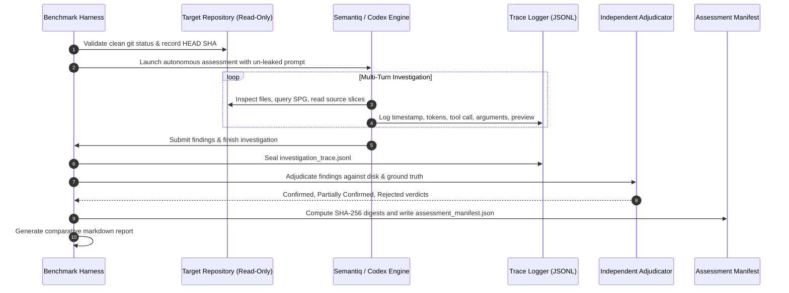

# Semantiq Security — Evaluation Methodology & Comparative Framework

## Executive Summary

This document specifies a reproducible, rigorous evaluation methodology for benchmarking AI-driven vulnerability discovery engines. It defines the standards for fair, un-leaked comparative evaluations between **Semantiq Security** and reference architectures (such as **Codex Security**), eliminating common evaluation pitfalls like prompt leakage, metric fabrication, and ungrounded mock runs.

---

## 1. Core Principles of Comparative Integrity

To ensure scientific credibility, all evaluations must satisfy four foundational principles:

```
┌─────────────────────────┐     ┌─────────────────────────┐     ┌─────────────────────────┐     ┌─────────────────────────┐
│   1. Zero Prompt        │     │  2. Dual-Labeled        │     │ 3. Independent          │     │ 4. Ground-Truth         │
│      Leakage Invariant  │     │     Counterexamples     │     │    Adjudication Gate    │     │    Preservation         │
├─────────────────────────┤     ├─────────────────────────┤     ├─────────────────────────┤     ├─────────────────────────┤
│ Prompts, tool specs,    │     │ Every vulnerability     │     │ Findings are evaluated  │     │ Ground-truth manifests  │
│ and memories must never │     │ must have a safe        │     │ by an automated gate    │     │ are locked before       │
│ disclose target flaws,  │     │ counterpart to test for │     │ checking exact code     │     │ runs; historical logs   │
│ file lines, or hints.   │     │ false-positive resistance│    │ citations & mitigations.│     │ are never overwritten.  │
└─────────────────────────┘     └─────────────────────────┘     └─────────────────────────┘     └─────────────────────────┘
```

1. **Zero Prompt Leakage Invariant:**
   - Evaluator prompts, system prompts, tool descriptions, and initial user instructions must be completely agnostic.
   - Prompts must **never** mention known vulnerability names, target file paths, specific function names, or expected finding counts.
   - Prior conversation memory or historical run artifacts must be strictly isolated to prevent cross-run context contamination.

2. **Dual-Labeled Counterexamples (Safe vs. Vulnerable):**
   - Testing only vulnerable repositories creates a biased environment where an agent that guesses "vulnerable" on every route appears competent.
   - Every benchmark suite must include paired vulnerable applications and safe counterpart implementations enforcing proper mitigations (e.g. `async_task_app` vs `async_task_safe`, `billing_reconciliation_app` vs `billing_reconciliation_safe`).

3. **Independent Evidence Adjudication:**
   - Adjudication must never rely on simple keyword matching (e.g. searching for the word "SQL" in finding text).
   - Findings must be adjudicated by verifying:
     - Exact file existence and line boundary validity on disk.
     - Accurate source snippet matching.
     - Reachable attacker entry point under stated preconditions.
     - True security invariant violation.
     - Absence of neutralizing mitigations (or correct classification of mitigating counterevidence).

4. **Historical Run Preservation:**
   - Never overwrite or overwrite previous evaluation records.
   - Baseline runs (e.g. `evals/real_world/`) and depth experiment runs (e.g. `evals/real_world_depth/`) must remain permanently preserved with immutable SHA-256 digests.

---

## 2. Benchmark Corpus & Target Specifications

The comparative evaluation utilizes a three-tier target corpus:

| Corpus Tier | Target Identifier | Repository & Commit | Focus & Purpose |
| :--- | :--- | :--- | :--- |
| **Tier 1: Synthetic Benchmarks** | `multitenant_saas_app` | `tests/fixtures/multitenant_saas_app` | Tests cross-tenant isolation and missing ownership checks. |
| **Tier 1: Synthetic Benchmarks** | `async_task_app` / `async_task_safe` | `tests/fixtures/async_task_app` | Tests asynchronous queue caller trust, re-authorization, and idempotency. |
| **Tier 1: Synthetic Benchmarks** | `billing_reconciliation_app` | `tests/fixtures/billing_reconciliation_app` | Tests financial double-claim concurrency and transaction hazards. |
| **Tier 2: Real-World Baseline** | `NASA-AMMOS/AIT-GUI` | `E:\bbp\NASA-AMMOS\AIT-GUI` (commit `b9df6fc`) | Real-world spacecraft telemetry/telecommand web operations console. |
| **Tier 3: Polyglot & Multi-Repo** | `NASA-AMMOS/AIT-Core` | `E:\bbp\NASA-AMMOS\AIT-Core` (commit `a01414c`) | Sibling dependency framework testing cross-workspace symbol resolution. |

---

## 3. Quantitative Evaluation Metrics

All benchmark runs must collect and report standard quantitative metrics:

### A. Discovery Performance Metrics
- **True Positives ($TP$):** Genuine vulnerabilities discovered with valid file citations, correct root causes, and verified reachability.
- **False Positives ($FP$):** Flaws submitted where the code is actually safe (mitigated by upstream middleware, confined by path guards, or non-existent).
- **False Negatives ($FN$):** Known ground-truth vulnerabilities present in the target that the investigator failed to discover.
- **Precision ($P$):**
  $$P = \frac{TP}{TP + FP}$$
- **Recall ($R$):**
  $$R = \frac{TP}{TP + FN}$$
- **$F_1$ Score:**
  $$F_1 = 2 \cdot \frac{P \cdot R}{P + R}$$

### B. Evidentiary Quality Metrics
- **Citation Validity Rate ($CVR$):**
  $$CVR = \frac{\text{Findings with valid file, line range, and source snippet}}{\text{Total submitted candidate findings}}$$
- **Proof-Gap Precision:** Percentage of unverified runtime or deployment assumptions correctly categorized under `coverage.deferred` rather than reported as confirmed exploits.
- **Connective Explanation Rate:** Percentage of code evidence steps accompanied by step-by-step explanatory reasoning.

### C. Resource & Efficiency Metrics
- **Total Token Consumption:** Combined prompt and completion tokens across all turns.
- **Tool-Call Efficiency ($TCE$):**
  $$TCE = \frac{TP}{\text{Total MCP Tool Calls}}$$
- **Elapsed Investigation Time:** Total wall-clock time in seconds.
- **Turn Count:** Total multi-turn rounds executed before termination.

---

## 4. Evaluation Workflow & Execution Protocol

Every benchmark run must follow a strict, automated 6-step protocol:



---

## 5. Standardized Finding Adjudication Decision Tree

When evaluating a submitted finding, the adjudicator executes this deterministic decision tree:

```
[Submitted Candidate Finding]
           │
           ▼
Does cited file exist in target or mapped dependencies?
    ├── NO  ──► [REJECTED: Missing File]
    └── YES
           │
           ▼
Is cited line range within file boundaries?
    ├── NO  ──► [REJECTED: Invalid Line Range]
    └── YES
           │
           ▼
Does cited source snippet match disk bytes?
    ├── NO  ──► [REJECTED: Mismatched Code Snippet]
    └── YES
           │
           ▼
Does cited code exhibit the claimed security weakness?
    ├── NO  ──► [REJECTED: Invalid Flaw Assumption]
    └── YES
           │
           ▼
Is the path neutralized by an effective guard, middleware, or sanitizer?
    ├── YES ──► [REJECTED or PARTIALLY_CONFIRMED: Mitigated by Guard]
    └── NO
           │
           ▼
Is the entry point reachable by an untrusted actor under stated preconditions?
    ├── NO  ──► [PARTIALLY_CONFIRMED / POTENTIAL: Unproven Reachability]
    └── YES
           │
           ▼
     [CONFIRMED VULNERABILITY]
```

---

## 6. Execution Manifest & Deliverables Requirement

Every comparative evaluation run must output exactly 6 immutable deliverable artifacts in its output directory:

1. `assessment_report.md`: Executive summary, comparative baseline delta, and detailed adjudicated finding writeups.
2. `findings.json`: Complete structured JSON records for all candidate, confirmed, partial, and rejected findings.
3. `investigation_trace.jsonl`: Turn-by-turn trace containing timestamps, token counts, tool calls, tool arguments, and results.
4. `coverage_summary.json`: Record of files explored, components inspected, dependency boundaries resolved, and deferred proof gaps.
5. `provider_run.json`: Model identifier, provider endpoint, duration, token usage, and completion timestamps.
6. `assessment_manifest.json`: Target repository commit, engine version, and cryptographic SHA-256 hashes of all artifacts.

