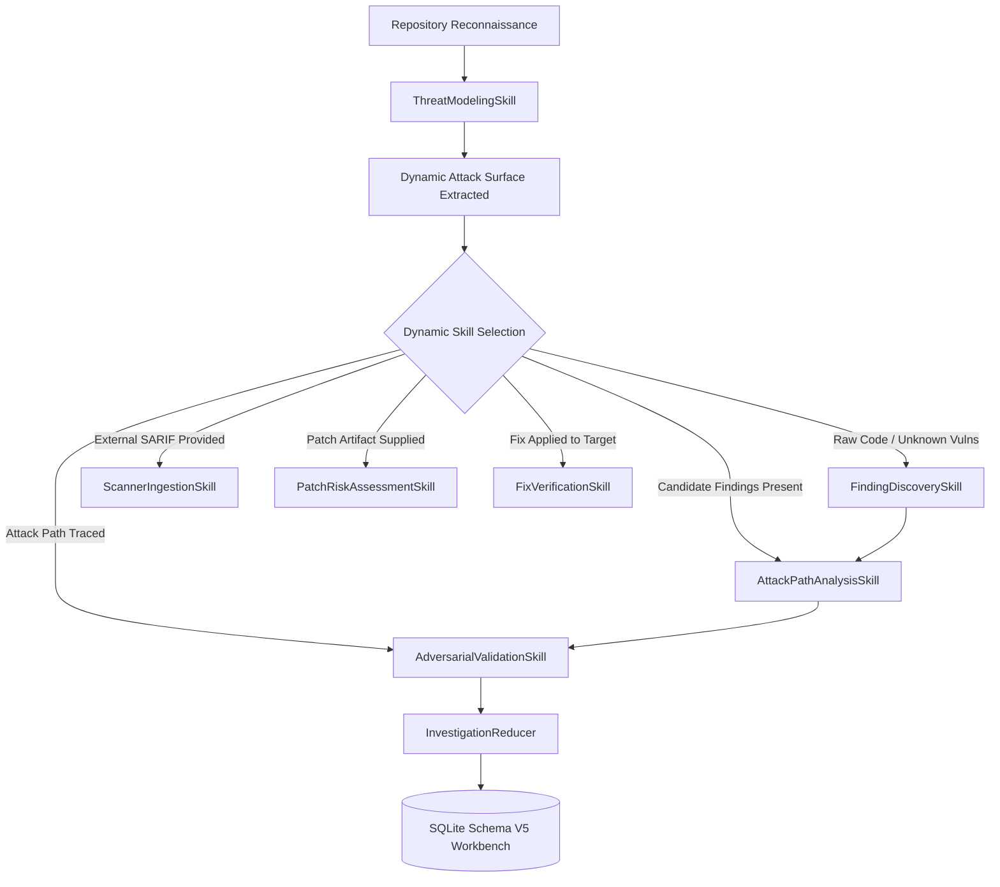

# Semantiq Security — Provider-Agnostic Skill Architecture Specification

**Workspace:** `e:/Semantiq-Security/semantiq-security`  
**Package Version:** `0.1.0` (Locked)  
**Date:** 2026-11-01  
**Status:** Approved Architecture Blueprint  

---

## 1. Design Objectives & Principles

The Semantiq Security Skill Architecture is designed to transform security capabilities from loose natural language prompts into **formally defined, machine-readable, testable, and sandboxed operational contracts**.

### Core Invariants:
1. **Contract-First & Type-Safe:** Every skill is governed by a Pydantic V2 immutable contract (`SecuritySkillContract`) declaring inputs, outputs, permissions, budgets, and dependencies.
2. **Deterministic Grounding:** Skills leverage deterministic code property graphs (`SemanticProgramGraph`), interprocedural dataflow (`SPGDataFlowAnalyzer`), and path traversal defense (`resolve_safe_path`) to ensure models never invent non-existent code paths.
3. **Provider-Agnostic:** Skills execute seamlessly across deterministic AST engines, local test mocks, Ollama, OpenAI, and Anthropic. If no AI API key is configured, the skill transparently executes its deterministic baseline and records `NOT_RUN` for model metrics.
4. **Fine-Grained Sandboxing:** Skills declare explicit permission requirements (`FILESYSTEM_READ`, `FILESYSTEM_WRITE`, `PROCESS_EXECUTION`, `NETWORK_ACCESS`, `GRAPH_QUERY`, `MCP_TOOLS`). Permissions are enforced strictly at runtime by `SkillSandbox`.
5. **Durable Telemetry:** Every skill execution records exact token consumption (input, cached input, output), tool call counts, latency, and status in `SkillExecutionTelemetry`, persisted to the SQLite Schema V5 workbench.

---

## 2. Component Architecture

The skill system resides in `src/semantiq/skills/`:

```text
src/semantiq/skills/
├── __init__.py           # Public exports (SecuritySkill, SkillRegistry, contracts)
├── contract.py           # SkillIdentifier, SecuritySkillContract, SkillBudget, SkillIO
├── sandbox.py            # SkillSandbox runtime permission enforcement
├── telemetry.py          # SkillExecutionTelemetry & token usage tracking
├── registry.py           # SkillRegistry (discovery, registration, dynamic selection)
└── operational/          # Verified, executable security skills
    ├── base.py           # BaseSecuritySkill abstract class
    ├── discovery.py      # FindingDiscoverySkill (SQ-SKILL-DISCOVERY)
    ├── attack_path.py    # AttackPathAnalysisSkill (SQ-SKILL-ATTACK-PATH)
    ├── threat_model.py   # ThreatModelingSkill (SQ-SKILL-THREAT-MODEL)
    ├── validation.py     # AdversarialValidationSkill (SQ-SKILL-VALIDATION)
    ├── patch_risk.py     # PatchRiskAssessmentSkill (SQ-SKILL-PATCH-RISK)
    ├── verify_fix.py     # FixVerificationSkill (SQ-SKILL-VERIFY-FIX)
    └── scanner_ingest.py # ScannerIngestionSkill (SQ-SKILL-SCANNER-INGEST)
```

---

## 3. Machine-Readable Skill Contract Specification

```python
class SecuritySkillContract(BaseModel):
    """Immutable machine-readable contract defining a security skill."""
    
    skill_id: str                      # e.g. "sq.skill.finding_discovery"
    name: str                          # Human-readable name
    description: str                   # Detailed description of purpose
    version: str = "0.1.0"             # Semver
    category: SkillCategory            # DISCOVERY, ANALYSIS, VALIDATION, REMEDIATION, INGESTION
    required_permissions: list[SkillPermission] # Filesystem read, write, execution, etc.
    required_inputs: list[str]         # Context keys that must be supplied
    optional_inputs: list[str] = []    # Context keys that are optional
    dependencies: list[str] = []       # Preceding skill IDs required
    budget: SkillBudget                # max_turns, timeout_seconds, max_tokens
    success_criteria: str              # Measurable criteria for success
    failure_conditions: list[str]      # Stopping conditions
```

### Permission Hierarchy (`SkillPermission`):
- `FILESYSTEM_READ`: Read files strictly within repository boundary via `resolve_safe_path`.
- `FILESYSTEM_WRITE`: Write patch artifacts to designated staging paths.
- `PROCESS_EXECUTION`: Execute non-destructive commands (e.g. test runner) with `shell=False`.
- `NETWORK_ACCESS`: Outbound tracking API calls (Linear, Jira, GitHub).
- `GRAPH_QUERY`: Read-only queries to `SemanticProgramGraph`.
- `MCP_TOOLS`: JSON-RPC tool invocation access.

---

## 4. Operational Skill Taxonomy

Semantiq implements 7 core operational skills covering the complete vulnerability lifecycle:

### 1. `FindingDiscoverySkill` (`sq.skill.finding_discovery`)
- **Category:** `DISCOVERY`
- **Permissions:** `[FILESYSTEM_READ, GRAPH_QUERY]`
- **Purpose:** Identifies candidate vulnerabilities across in-scope files using AST rules, route boundaries, and dynamic attack surface seeds.
- **Output:** List of `Finding` candidates with initial evidence, source locations, and proof gaps.

### 2. `AttackPathAnalysisSkill` (`sq.skill.attack_path_analysis`)
- **Category:** `ANALYSIS`
- **Permissions:** `[FILESYSTEM_READ, GRAPH_QUERY]`
- **Purpose:** Traces multi-hop interprocedural paths from untrusted routes/entrypoints to sensitive sinks using `SPGDataFlowAnalyzer`. Calibrates finding severity based on exploit reachability.
- **Output:** Updated findings with ordered `code_evidence` and `structured_attack_chain`.

### 3. `ThreatModelingSkill` (`sq.skill.threat_modeling`)
- **Category:** `THREAT_MODELING`
- **Permissions:** `[FILESYSTEM_READ, GRAPH_QUERY]`
- **Purpose:** Maps external entry points, authentication boundaries, data storage assets, and trust invariants across web frameworks.
- **Output:** Formally populated `ThreatModel` object with boundary and route mappings.

### 4. `AdversarialValidationSkill` (`sq.skill.adversarial_validation`)
- **Category:** `VALIDATION`
- **Permissions:** `[FILESYSTEM_READ, GRAPH_QUERY]`
- **Purpose:** Actively searches for defensive guards, sanitizers, and authorization checks along the attack path using `PathAdversarialVerifier`. Downgrades or refutes findings when neutralizing controls exist.
- **Output:** Validation status (`CONFIRMED`, `REFUTED`, `INCONCLUSIVE`), counterevidence, and updated proof gaps.

### 5. `PatchRiskAssessmentSkill` (`sq.skill.patch_risk_assessment`)
- **Category:** `REMEDIATION`
- **Permissions:** `[FILESYSTEM_READ]`
- **Purpose:** Analyzes an immutable unified diff patch against target contracts, evaluating regression risk, syntax validity, contract breakage, and auto-merge eligibility.
- **Output:** `PatchRiskReport` with recommendation (`SAFE_TO_MERGE`, `REQUIRES_HUMAN_REVIEW`, `BLOCK`).

### 6. `FixVerificationSkill` (`sq.skill.fix_verification`)
- **Category:** `REMEDIATION`
- **Permissions:** `[FILESYSTEM_READ, GRAPH_QUERY]`
- **Purpose:** Read-only verification that an applied code fix closes the specific vulnerable boundary without introducing regression side-effects.
- **Output:** Verification verdict (`FIXED`, `STILL_VULNERABLE`, `INCONCLUSIVE`) with source evidence.

### 7. `ScannerIngestionSkill` (`sq.skill.scanner_ingestion`)
- **Category:** `INGESTION`
- **Permissions:** `[FILESYSTEM_READ]`
- **Purpose:** Parses and normalizes external security reports (OASIS SARIF 2.1.0, Semgrep JSON, Snyk JSON) into standard Semantiq `Finding` contracts for investigation and validation.
- **Output:** Standardized `Finding` instances ready for investigation.

---

## 5. Dynamic Skill Selection Engine

The `SkillRegistry` provides dynamic selection based on repository context:



---

## 6. Telemetry & Transparency Contract

Every skill execution generates a `SkillExecutionTelemetry` record:
- Total input, output, and cached input tokens.
- Latency in milliseconds.
- Tool call counts and names.
- Explicit provider status: `LIVE_ACTIVE` or `NOT_RUN (deterministic engine)`.
- Telemetry records are committed to the `audit_log` and `scans` tables in the SQLite workbench.

