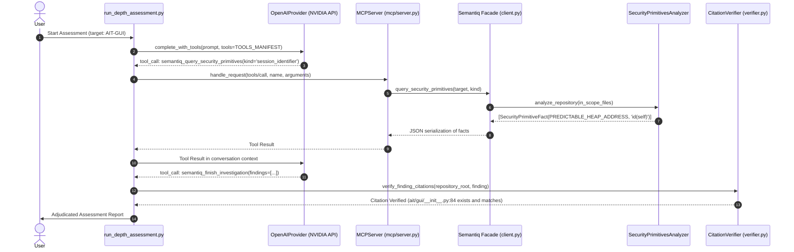

# Semantiq Security — Architectural Gap Analysis

## Executive Summary

This document provides a critical internal audit of **Semantiq Security** (`v0.1.0`), evaluating its current architectural state against the design patterns identified in the Codex Security reference study.

While Semantiq possesses superior deterministic static analysis foundations (Semantic Program Graph, interprocedural taint analysis, asynchronous boundary modeling, and static security primitive classification), it suffers from architectural bottlenecks in **agent orchestration, finding schema richness, multi-worker parallelization, evidence-contract sealing, and semantic deduplication**.

---

## 1. Audit of Existing Semantiq Components

### A. Semantic Program Graph (SPG) & Interprocedural Taint
- **Components:** [`src/semantiq/graph/`](file:///e:/Semantiq-Security/semantiq-security/src/semantiq/graph/), [`src/semantiq/analysis/spg_dataflow.py`](file:///e:/Semantiq-Security/semantiq-security/src/semantiq/analysis/spg_dataflow.py), [`interprocedural.py`](file:///e:/Semantiq-Security/semantiq-security/src/semantiq/analysis/interprocedural.py).
- **Strengths:** 
  - Represents code as a typed property graph (`ROUTE`, `SENSITIVE_SINK`, `CALL`, `FUNCTION`, `VARIABLE`, `QUERY`, `AUTH_BOUNDARY`).
  - Capable of computing deterministic paths from HTTP entry points to dangerous sinks.
- **Current Bottlenecks & Gaps:**
  - The SPG is currently constructed only for Python files; JS/TS files are analyzed through shallow regex patterns (`regex_patterns.py`).
  - The graph is not automatically surfaced to the AI investigator in full; the investigator queries it via discrete MCP tools (`query_dataflow_path`, `query_route_reachability`), which return JSON lists rather than structured graph context.
  - Dynamic calls (`getattr`, `eval`, variable functions) create graph gaps that are reported as `unresolved_regions` rather than proactively resolved through runtime heuristic clues.

### B. Asynchronous Flow Modeling
- **Components:** [`src/semantiq/analysis/async_flow.py`](file:///e:/Semantiq-Security/semantiq-security/src/semantiq/analysis/async_flow.py).
- **Strengths:**
  - Correlates message producers to background consumers across queues (Celery, RQ, in-memory).
  - Evaluates worker-side re-authorization, tenant isolation, and idempotency hazards.
- **Current Bottlenecks & Gaps:**
  - Fully implemented and covered by unit tests, but **under-utilized by the AI investigator**. In the live NASA-AMMOS assessment, the model focused almost exclusively on synchronous routes (`/cmd`, `/tlm`) and rarely invoked `query_async_flows`.

### C. DependencyResolver & SecurityPrimitivesAnalyzer
- **Components:** [`src/semantiq/analysis/dependency_resolution.py`](file:///e:/Semantiq-Security/semantiq-security/src/semantiq/analysis/dependency_resolution.py), [`security_primitives.py`](file:///e:/Semantiq-Security/semantiq-security/src/semantiq/analysis/security_primitives.py).
- **Audit Question:** *Are they actually used by the investigator or merely exposed as standalone tools?*
- **Empirical Evidence from Live Assessment Trace (`evals/real_world_depth/investigation_trace.jsonl`):**
  - In Turn 3, the model invoked `semantiq_query_security_primitives(kind='session_identifier')`.
  - Semantiq returned the fact: `prim:ait/gui/__init__.py:id:84` (`PREDICTABLE_HEAP_ADDRESS`, `id(self)`).
  - In Turn 4, the model followed up with `semantiq_query_security_primitives(kind='csrf_token')`, receiving `_enforce_same_origin`.
  - In Turn 8, the model inspected the exact source lines of `Session.id` using `semantiq_get_source_excerpt`.
  - In Turn 12, the model submitted `finding-1: Predictable Session Identifier` citing line 84.
- **Conclusion:** **The SecurityPrimitivesAnalyzer is actively and successfully used by the live investigator**, directly producing confirmed discoveries.
- **Remaining Gap in DependencyResolver:** While `DependencyResolver` was used in unit tests to map `AIT-Core`, the live investigator did not proactively call `semantiq_resolve_dependency_symbol` during its 12 turns on AIT-GUI because it focused its budget on the discovered session primitive. The tool is functional, but the investigator needs stronger prompt incentives to trace external class inheritance.

### D. Model Integration & Investigation Orchestrator
- **Components:** [`src/semantiq/providers/live.py`](file:///e:/Semantiq-Security/semantiq-security/src/semantiq/providers/live.py), [`orchestrator.py`](file:///e:/Semantiq-Security/semantiq-security/src/semantiq/discovery/orchestrator.py), [`investigation_tools.py`](file:///e:/Semantiq-Security/semantiq-security/src/semantiq/discovery/investigation_tools.py).
- **Strengths:** Robust tool execution dispatcher, error containment, citation verification.
- **Current Bottlenecks:**
  - Runs as a **single linear multi-turn loop**. If a repository has 20 components, one model agent must sequentially explore them turn-by-turn within a fixed token/turn budget (12-14 turns).
  - Lacks Codex's multi-phase division (Discovery -> Attack Path -> Validation -> Remediation). All phases are compressed into a single turn loop.

---

## 2. Real Execution Path Trace

To verify architectural integrity, here is the traced execution path from user request to model tool call to analysis output:

---

## 3. Disconnected Components & Duplications in Semantiq

1. **Dual Scan Paths:**
   - Semantiq has two separate scanning mechanisms:
     - `VulnerabilityDiscoveryEngine` ([`src/semantiq/discovery/engine.py`](file:///e:/Semantiq-Security/semantiq-security/src/semantiq/discovery/engine.py)): Executes deterministic AST rule checks (`SQ-PY-001` through `SQ-PY-017`).
     - `LiveAIInvestigator` ([`src/semantiq/providers/live.py`](file:///e:/Semantiq-Security/semantiq-security/src/semantiq/providers/live.py)): Runs autonomous multi-turn tool calling.
   - **Disconnection:** AST rule findings generated by `VulnerabilityDiscoveryEngine` are not automatically seeded as candidate leads into `LiveAIInvestigator`. Codex Security explicitly uses scanner findings (Semgrep, Snyk) as **amplification seeds** for deep attack-path exploration.
2. **Finding Deduplication Disconnection:**
   - In Semantiq, findings are deduplicated solely by exact fingerprint hash (`rule_id + file_path + start_line + end_line`).
   - If the AI investigator discovers the same vulnerability on line 84 and describes it with a slightly different title or line range (e.g. lines 82-85), Semantiq treats them as two distinct findings.
3. **Storage Disconnection:**
   - `SQLiteStorage` maintains a lightweight schema (`findings`, `hypotheses`). It does not store intermediate scan progress, file coverage surfaces, or triage decisions, leading to state loss across CLI invocations unless explicitly exported to JSON.

---

## 4. The 5 Most Consequential Architectural Gaps

### Gap 1: Absence of Parallel Multi-Worker Deep Scan (High Consequence)
- **Codex Reference:** `DeepScanCoordinator` partitions the target repository into independent investigation packets, launches parallel discovery workers (`fork_turns: "none"`), collects candidate artifacts, and runs a reducer.
- **Semantiq Reality:** Semantiq runs a single-threaded linear turn loop. On repositories larger than 50 files, a single agent exhausts its turn budget exploring high-level files and never reaches deep modules.
- **Remediation:** Introduce `DeepScanCoordinator` in Semantiq that partitions repositories by component/package, spawns parallel subagent discovery passes, and aggregates findings through a central reducer.

### Gap 2: Lack of Two-Stage Finding Deduplication & Merging (High Consequence)
- **Codex Reference:** Employs vector embeddings to group candidate findings into semantic neighborhoods, followed by an LLM pairwise reviewer that synthesizes an inclusive merged finding (`mergedFinding`), preserving all affected locations and candidate IDs.
- **Semantiq Reality:** Pure syntactic hash matching. Duplicate observations across different turns or workers split into redundant findings rather than merging.
- **Remediation:** Implement a two-stage deduplication pipeline: syntactic clustering (by file, component, and CWE) followed by an LLM pairwise review that reconciles duplicates into single canonical findings.

### Gap 3: Flat Evidence Schema vs. Semantic Role-Based Evidence (Medium-High Consequence)
- **Codex Reference:** `codeEvidence` mandates 7 semantic roles (`user_input`, `entrypoint`, `propagation`, `root_control`, `sink`, `outcome`, `expected_control`) with connective explanations and an ordered `rootCause.evidenceRefs` array.
- **Semantiq Reality:** Semantiq's `CodeEvidence` has simple string snippets and basic roles (`source`, `sink`). It lacks the step-by-step connective explanation explaining why each transition preserves or violates an invariant.
- **Remediation:** Upgrade `CodeEvidence` and `Finding` models in [`src/semantiq/models.py`](file:///e:/Semantiq-Security/semantiq-security/src/semantiq/models.py) to support semantic roles and connective explanations.

### Gap 4: Missing Epistemological Coverage & Proof-Gap Ledger (Medium Consequence)
- **Codex Reference:** Explicitly distinguishes confirmed findings from `coverage.deferred` (Proof Gaps) and `coverage.surfaces`. If a finding requires an unproven runtime assumption, it is recorded under deferred work rather than fabricated or discarded.
- **Semantiq Reality:** Semantiq forces a binary decision in adjudication: `CONFIRMED`, `PARTIALLY_CONFIRMED`, or `REJECTED`. There is no structured ledger for recording unanswered architectural questions or deferred investigation tasks.
- **Remediation:** Add `coverage.deferred` and `coverage.open_questions` to Semantiq's scan result and report schemas.

### Gap 5: Lightweight Storage vs. Full Audit Workbench State (Medium Consequence)
- **Codex Reference:** 32 normalized SQLite tables tracking scans, findings, locations, occurrences, embeddings, triage reviews, publication receipts, and deep scan worker states across 53 schema migrations.
- **Semantiq Reality:** A minimal SQLite schema with only `findings` and `hypotheses` tables.
- **Remediation:** Expand [`src/semantiq/storage/sqlite.py`](file:///e:/Semantiq-Security/semantiq-security/src/semantiq/storage/sqlite.py) to store scan runs, finding occurrences, coverage surfaces, and triage review records.

---

## 5. Components to Preserve vs. Components to Redesign

### What Should Be Preserved & Leveraged:
1. **Semantic Program Graph (`src/semantiq/graph/`):** Maintain and expand. Codex lacks this completely; Semantiq's SPG is a distinct competitive advantage for ground-truth reachability.
2. **Interprocedural Dataflow & AST Visitors (`src/semantiq/analysis/`):** Preserve deterministic taint propagation.
3. **Async Flow Analyzer (`src/semantiq/analysis/async_flow.py`):** Preserve and wire directly into threat modeling.
4. **DependencyResolver (`src/semantiq/analysis/dependency_resolution.py`):** Preserve sibling workspace mapping and static symbol resolution.
5. **SecurityPrimitivesAnalyzer (`src/semantiq/analysis/security_primitives.py`):** Preserve entropy classification and cookie defense correlation.
6. **Path Resolution Defense (`src/semantiq/repository/safepath.py`):** Preserve NTFS stream and traversal protections.

### What Needs Redesign & Expansion:
1. **Investigation Orchestration (`src/semantiq/discovery/orchestrator.py`):** Redesign from a single linear turn loop to a staged coordinator that supports parallel discovery workers and reducer passes.
2. **Finding Data Model (`src/semantiq/models.py`):** Expand `CodeEvidence` to include the 7 semantic roles, connective explanations, and proof gaps.
3. **Storage Layer (`src/semantiq/storage/sqlite.py`):** Expand schema to persist scan runs, occurrences, coverage surfaces, and triage state.
4. **Adjudication & Finalization:** Implement a formal contract finalizer (`contract_finalizer.py`) that seals scan artifacts and validates JSON schemas before export.

